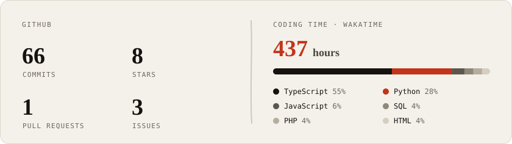

 [![FynxForge](https://img.shields.io/badge/FynxForge-F4F1EA?style=flat-square&logo=data%3Aimage%2Fpng%3Bbase64%2CiVBORw0KGgoAAAANSUhEUgAAACQAAAAdCAYAAADCdc79AAAIEUlEQVR42r1WaXhV1RVd%2B97zkpv3XpIXH5KBWkzjACKDZEBJJRClDlEaa0Mtk4xBhoqCIDK9F6gUUYZURJOqcQDBAB9gqIJBkE%2BmhCQMEbQMAcFMkhDN9IZ779n9QcKHIGWSnr%2F3u2evs%2FZaa29KS0tTV61aZaaPGTf7weTkhKFPD364ubkZWVlZltGjR%2Bsejyda0zQLABU39lQT0RkCgEGDhvYs2b8%2FPzw83PpE6uMr%2FzZu7EwiOpqfn%2F%2B7o8eOF%2B87cMBx5kydrmmaCoDA%2FKuhYGZWhSC%2Fz38k5s6YxwQz21L6pWZ5PB5rWVmZ%2F92cD546efLUw%2Fv2lU7o3r3rB6tXr44zTXP26dM1Aw4eOgQwmwEBgaqUEkQAAyAARHStmIgBtghxx%2Ffl339EAPD6kqVrV3ycm1peXqFbLBbV5%2FMpCQkJuKf7PR9Nf%2FEFNxEd2bhxc%2Bpnmz57o6CwKKqiosKwWq2CmUFEME0Tuq7La4NDADMriqKm%2FflJUN2GBe85UiZOmTN3Xt66tesSTtfU%2Bu12u6W%2Bvl46nU61W9eu%2FECf3suHDBk4FYB%2FaVb2%2FM35W4YWl5TIoCBNMQwTVqsVkZERYG7l6%2Brw6IaBTh07Nk6dMukJ4vUurm7wfBo%2B8JX%2B8xdmbtq8aVNi6cFDRmhoqGIYhvT6fCIqIgIJCfHy3oT4NydMGD%2F%2Bpemzlrz%2F4fJxPq%2FX9Hi8at8Hkxsz5rgfKygsbLJYLICuX4WGBNscNurcoUNNZGTkCVGFkH1a%2Be5H61ZMWTNl4vzZke1v%2B33%2BJ6tnFhQWwTRNtttsZk1tLdZ%2FkqfuP1A67sm0v97fJ6l3dlFRMXbu2g1FIQQEBBi3REbu%2BG1qqnGdAldEWOwfZtVXHvrEU7r1oaa6YYlPdemV8WB2TsorM6ZP3FtU8EBFZRVUVTUDAwNRXl5unjp1qguAJVFRURBCKIZhgKUkADdlZmb%2BFBISQvX19Vdtw8TERElEOjGzqN3%2B8btq8arBFWXfwtnuVugBwZ%2F%2FZvjMxQvXlNLGle%2B7yysq45uamw1N04SUUvp8PgoLCyOfz8cNDQ3U77GUH1eu%2BDCsru7H644BcgFKBiAbty97vXHfxvH%2BqjKwqUMNDUdY%2Bw7%2FsD716ryXZrhzt2754qHKqmojKChIMDNM04QQgj0eD%2FWIj%2FP26Z00v7q62qcoCq7KblJKp9OpdOvWpbJXr145xMxUvGfP1DbRnQvbhxyt%2BSFn8WRfY%2F1AtfEHOIJU1AVHF7Qb83aff77x1tply5Y%2FVFNTIy0Wi8IXhKPD4QARgZlx%2FjciumRGKYqCxoYGdOvWDcOHDpqUnJy8kABg5co1z534rmxRsMM5eWz6sM%2Fh%2F5abV2cnNXj8z4Y0V95eF9j2QFT6m0nTps3KW7NufU8pTSYitbWgX9dlc1OzDwACAwOExWJBa0bpug6fz29cbHeC3%2B83o6NvtY8aNSJvTPrIfi6XSyEwEwNwZcw%2B8sWWbTGdOnbgmyPbfRjfu%2B%2B2PybFn0TJ%2B%2F6mw1%2B%2F6bv5zm%2BOdx05I%2FOF4d9s2brNtNlsKgDouo6oqCjcFhMDyRLHy46jsqoKqqrCNE1EhIcjJiYGpjRB52UUg6EoCm52OncseO2VFLfb3eR2u03BABGRZOaBqvLyv5evyHUahj5k51fbhnycHdHU%2Fs673nrx2emDAiq%2Bfia2DU7FxMTkl%2Bzd39fr9ZqqqhIAxel0bps%2F7%2B%2B5VquVsrLfnrFk6VsRQgjJzErKow9XjR03es7p6tMkhDi%2Fz2y1Wqlt27bLiKiemYmIWBCRdLlcChEVeNmb6HA4ntuxc9fgsuMnbMe%2FK7QVlRRPaqo7PXL8cy8OrHC7fQn3JX66fceuvocPH4aiKKamaUpxSfGe8PDwpQAwf8HCZ4QQEVJKKYRFMU2z1hHiWHqZ%2FCEiYgAQAJCRkSFdLpeikfYfAGO8Xm%2Fmhk83jj548NCtJ06cSCooKAyrz5j2xnvv%2Fit6V8muDcF22yJmKC3Mwm6zW5lZAKBXFy46N%2BOYGVarjQMCBPwXyCgtLVfNzU0jAGYrmHOAWkExs9K%2Ff3%2FSNO1bAM%2BrqgrDMMLfeSdnROnBQy%2B%2FPG%2FeqOlTp66%2F%2FbYNKCgsOv%2BFkogMZm5dAEAEkpJRuGdPVMrjf1rQ7PWRqijs83q4S5cuYuFraS8RkYeZf2ZBcYHyJQC4XC4FgJKRkSGJqBrA3N2799SWlpY6AXCoIxTMZ9ePS%2FfhrNuLiktuslqtE4kIhmFA0zQE2%2B2rAJhpaWkqEZmXBHQ%2BW8DZfGNmcrvd6r33xmcBwMiRw%2B5ieeXRZxgm6urqABAkSzzSo8fJDPfMp4nI36IdXBbQBawxAKOoqMiSl5dnoqUlV7JXmIaBnvf10Dt3vrvCNCUD8qcAEfQXIvK0GOmil4krfWlsbKwZFxcn3W73lU5uqSiqEh8fe%2FT5Cc%2FeDYCCg%2B1mY2NTq6t%2BkWZxI7d2IkJTYxOEUKVpnq1%2FKWbOjZMbDUghkkIItK6SLfrE%2FxXQWaGS9Hq9TKoafDX%2Fimur9z8mOBEbhiGJKKDX%2FYm4pV27ubpu%2FCyNf21Aht%2Fvh9%2Bv8y9pwW8YqtVmU5L79D4yeMAAd48ecR9dTjfX1LLWmQfgqLNNm%2By42FjF4%2FEGSimZlLNsaZrGdqutfsTQoXtfX7ygTwsYcTndXNdxuVyKECq%2B%2FPKr9JGjxx7t1DWW28fckdnK%2BLFjx8KZWQGArVu33lAXX8QsM4dOmDh5xSMp%2FXIAID093XI%2B8Gu5%2BL8%2F29ydWRoKtgAAAABJRU5ErkJggg%3D%3D&labelColor=F4F1EA)](https://fynxforge.com)  

### 一 &nbsp;The short version

I started out building websites, then moved into machine learning and data science, and now I take products from the web layer down to the model and back: **web → ML → AI → mobile**. Five models shipped, 10K+ users served, seven products in production. I co-founded **[FynxForge](https://fynxforge.com)** in 2026.

### 二 &nbsp;Selected work

- **[AdviceBuddy.ai](https://ahmed.fynxforge.com/work/advicebuddy)**: An AI mental-wellness companion with crisis handling built in
- **[SaudizationMeter](https://ahmed.fynxforge.com/work/saudizationmeter)**: A Nitaqat compliance SaaS for Saudi employers
- **[KryticalStyle](https://ahmed.fynxforge.com/work/kryticalstyle)**: Headless e-commerce for a Saudi casual-luxury label *(FynxForge)*
- **[Clinical Monitoring Platform](https://ahmed.fynxforge.com/work/clinical-platform)**: Preventive-medicine HealthTech, confidential *(FynxForge)*
- **[Ramy Wakem](https://ahmed.fynxforge.com/work/ramywakem)**: The website for an accounting and tax firm

### 三 &nbsp;Open-source ML

- **[Enterprise RAG System](https://github.com/phoenixak/RAG-System)**: retrieval-augmented QA over company documents. [Live demo ↗](https://huggingface.co/spaces/Phoenixak99/RAG-System-Demo)
- **[NLP Analysis Pipeline](https://github.com/phoenixak/Analyzing-Car-Reviews-with-LLMs)**: analysing car reviews with LLMs. [Live demo ↗](https://huggingface.co/spaces/Phoenixak99/car-reviews-analyzer)

  
    
  
    
  

