    

### 一 &nbsp;The short version

I started out building websites, then moved into machine learning and data science, and now I take products from the web layer down to the model and back: **web → ML → AI → mobile**. Five models shipped, 10K+ users served, seven products in production. I co-founded **[FynxForge](https://fynxforge.com)** in 2026.

### 二 &nbsp;Selected work

| | |
|---|---|
| **[AdviceBuddy.ai](https://ahmed.fynxforge.com/work/advicebuddy)** | An AI mental-wellness companion with crisis handling built in |
| **[SaudizationMeter](https://ahmed.fynxforge.com/work/saudizationmeter)** | A Nitaqat compliance SaaS for Saudi employers |
| **[KryticalStyle](https://ahmed.fynxforge.com/work/kryticalstyle)** | Headless e-commerce for a Saudi casual-luxury label *(FynxForge)* |
| **[Clinical Monitoring Platform](https://ahmed.fynxforge.com/work/clinical-platform)** | Preventive-medicine HealthTech, confidential *(FynxForge)* |
| **[Ramy Wakem](https://ahmed.fynxforge.com/work/ramywakem)** | The website for an accounting and tax firm |

### 三 &nbsp;Open-source ML

- **[Enterprise RAG System](https://github.com/phoenixak/RAG-System)**: retrieval-augmented QA over company documents. [Live demo ↗](https://huggingface.co/spaces/Phoenixak99/RAG-System-Demo)
- **[NLP Analysis Pipeline](https://github.com/phoenixak/Analyzing-Car-Reviews-with-LLMs)**: analysing car reviews with LLMs. [Live demo ↗](https://huggingface.co/spaces/Phoenixak99/car-reviews-analyzer)

### 四 &nbsp;Ink on paper

  
   
  
   
  
    
  
   
  
  

